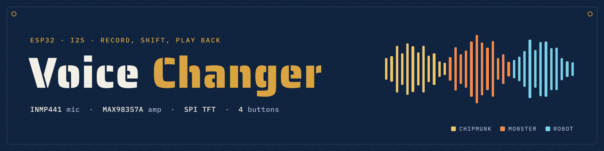
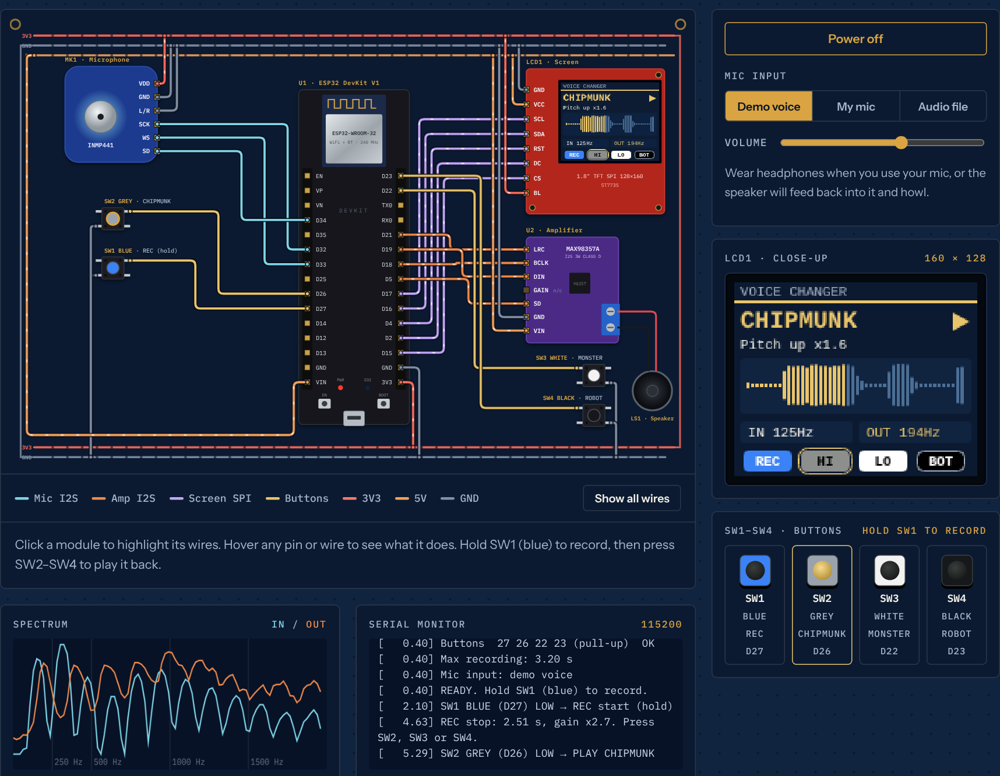
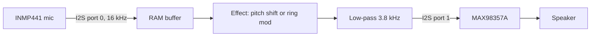

<div align="center">



<br>

[](LICENSE)
[](https://www.espressif.com/)
[](https://www.arduino.cc/)
[](firmware/VoiceChanger/VoiceChanger.ino)
[](https://zeyad-101.github.io/Voice-Changer-/)

[Simulation](#-simulation) · [Effects](#-effects) · [Hardware](#-hardware) · [Build](#-build-and-flash) · [How it works](#-how-it-works) · [Troubleshooting](#-troubleshooting)

</div>

---

Hold a button, speak, let go, then play your voice back as a chipmunk, a monster or a robot. Everything runs on one ESP32. There is no cloud and no PC in the loop. A small TFT shows the state, a waveform of the recording, and the pitch of your voice in Hz.

## 🧪 Simulation

The repo includes a browser simulation of the whole build. It has the wiring diagram, a TFT close-up, the four buttons, a spectrum view and a serial monitor. You can drive it with a demo voice, your own mic, or an audio file.

**[Open the live simulation](https://zeyad-101.github.io/Voice-Changer-/)**



The page is a single file at [`docs/index.html`](docs/index.html). It also contains a copy of the firmware, with a copy button.

## 🎵 Effects

| Button | Pin | Action | How it is done |
| :--- | :--- | :--- | :--- |
| Blue | D27 | Record (hold) | Records only while held. Stops when RAM is full. |
| Grey | D26 | Chipmunk, pitch x1.6 | Two-head crossfaded pitch shifter, 50 ms window |
| White | D22 | Monster, pitch x0.65 | Same shifter, 75 ms window |
| Black | D23 | Robot | Ring modulation with a 50 Hz sine |

Pressing an effect button during playback restarts it with that effect. Pressing Blue during playback stops it and starts a new recording.

## 🔌 Hardware

| Part | Used for |
| :--- | :--- |
| ESP32 DevKit V1 | Controller |
| INMP441 | I2S MEMS microphone |
| MAX98357A | I2S amplifier, drives the speaker |
| ST7789 or ST7735 SPI TFT | Status screen |
| 4 push buttons | Record and three effects |

### Wiring

| Part | Pin | ESP32 |
| :--- | :--- | :--- |
| TFT | SCL, SDA, CS, DC, RST | D17, D16, D15, D2, D4 |
| TFT | BL, VCC, GND | 3V3, VIN, GND |
| Amp | LRC, BCLK, DIN, SD | D21, D18, D19, D5 |
| Amp | VIN, GND | VIN (5 V), GND |
| Mic | SD, WS, SCK | D34, D33, D32 |
| Mic | L/R, VDD, GND | GND, 3V3, GND |
| Buttons | Blue, Grey, White, Black | D27, D26, D22, D23 |

Wire each button between its pin and GND, using one diagonal pair of legs. The buttons use the internal pull-ups.

> [!WARNING]
> Power the INMP441 from 3V3, not 5 V.

The simulation page has the same wiring as an interactive diagram. Click a module to highlight its wires.

## 🔧 Build and flash

1. Install the Arduino IDE and the **esp32 by Espressif Systems** board package, version 3.x.
2. Install the libraries **Adafruit ST7735 and ST7789 Library** and **Adafruit GFX Library**.
3. Select the board **ESP32 Dev Module**.
4. Open `firmware/VoiceChanger/VoiceChanger.ino` and upload.
5. Open the serial monitor at 115200 baud to see button presses and state changes.

### First boot: screen setup

Screens that share the same pins differ in size and driver, so you pick yours on the device. On the first start the setup screen appears.

| Button | Action |
| :--- | :--- |
| Grey | Next screen type |
| White | Rotate |
| Blue | Save and start |

Choose the setting where the white frame touches all four edges of the glass and the four corner squares are visible. The choice is stored in flash. To open the setup again, hold Grey while powering on.

Seven screen profiles are built in: ST7789 at 240x320, 240x240, 240x280, 170x320 and 135x240, and ST7735 at 128x160 in the black-tab and green-tab variants. To skip the setup, set `FORCE_PROFILE` and `FORCE_ROTATION`.

### Speaker test

Hold White while powering on. You should hear a clean 440 Hz tone for 2 seconds.

### Settings

These are at the top of the sketch.

| Setting | Default | Meaning |
| :--- | :--- | :--- |
| `SAMPLE_RATE` | 16000 | Sample rate in Hz |
| `MAX_SECONDS` | 8 | Upper limit for one recording. The real limit is free RAM. |
| `PITCH_HIGH` | 1.6 | Grey button pitch ratio |
| `PITCH_LOW` | 0.65 | White button pitch ratio |
| `ROBOT_HZ` | 50 | Ring modulation frequency |
| `OUT_VOLUME` | 0.40 | Output level from 0.0 to 1.0 |
| `NOISE_GATE` | 1 | Lowers the gaps between words to cut hiss |
| `TONE_CUT_HZ` | 3800 | Treble cut on playback |
| `TFT_SPI_HZ` | 27000000 | SPI clock for the screen |

## 🧠 How it works



**Capture.** The mic is read only while Blue is held. The INMP441 sends a 24-bit sample in a 32-bit slot, and the sketch shifts it down to 16 bits with some headroom. A high-pass filter at about 115 Hz removes DC offset and handling thumps. The ESP32 can swap the left and right slots, so the sketch measures activity on both at start-up and picks the live one.

**After recording.** The first 40 ms and the last 60 ms are dropped to remove the button clicks. The recording is then normalized to about 90 % of full scale, with a maximum gain of x16, and the optional noise gate runs over it in 16 ms blocks.

**Playback.** The pitch shifter reads the buffer with two heads and crossfades them, so the recording keeps its length. The robot effect multiplies the samples by a 50 Hz sine. A low-pass filter then cuts treble hiss, and the result goes to the amp on its own I2S port. The amp's SD pin is high only while sound plays.

**Display.** The screen layout is computed from the real screen size. The tape draws one bar per slice of the recording and recolors the bars as playback passes them. An autocorrelation pitch detector shows the input and output frequency while recording and playing.

**Memory.** With PSRAM the buffer holds up to `MAX_SECONDS`. Without it, the sketch takes the largest free heap block and leaves 24 KB for the system. The firmware header estimates about 3 seconds in that case.

## 🩺 Troubleshooting

| Symptom | What to check |
| :--- | :--- |
| Dirty or crackling tone in the speaker test | Power and speaker wiring. Lower `OUT_VOLUME`. High volume makes the amp clip and the USB supply sag. |
| `No mic signal!` on the ready screen, or `Very quiet!` in the serial monitor | Mic wires: SD to D34, WS to D33, SCK to D32, VDD to 3V3. |
| Screen is blank, shifted or wrongly sized | Hold Grey at power-on and pick another screen type or rotation. |
| `TOO SHORT` after recording | The recording was under 0.1 s. Hold Blue longer. |
| `Memory full. Let go` while recording | The buffer is full. Release Blue. |
| `I2S ERROR` or `RAM ERROR` on start | Audio driver or buffer allocation failed. Check the board package is 3.x and the board is set to ESP32 Dev Module. |

## 📁 Repository layout

```
firmware/VoiceChanger/VoiceChanger.ino   Arduino sketch
docs/index.html                          Simulation and wiring guide
docs/media/                              README images
LICENSE
```

## 📄 License

MIT. See [LICENSE](LICENSE).
